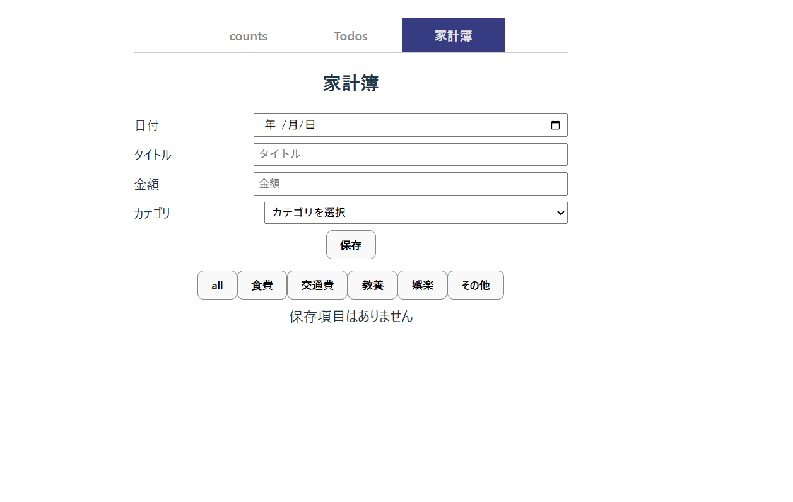
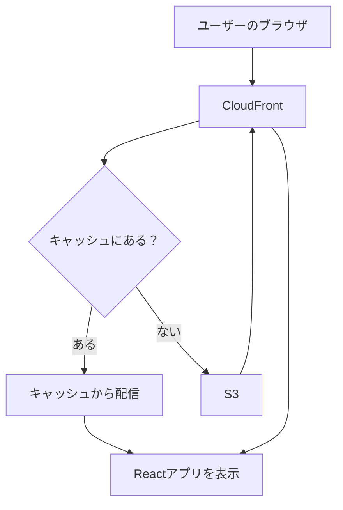
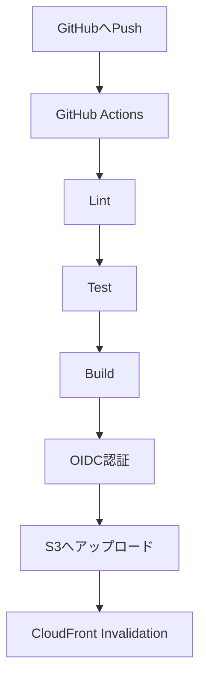

## 家計簿アプリ

（React × TypeScript × AWS × GitHub Actions）

React / TypeScriptで開発した家計簿アプリです。

設計・リファクタリング・テスト・CI/CD・AWSデプロイまでを継続的に改善し、実務を意識した開発プロセスを学ぶことを目的としています。

- --

## デモ

## 主な機能

- 家計登録
- 編集
- 削除
- カテゴリごとに表示
- ローカルストレージへ保存
- 何個中何個終わった表示

- --

## このプロジェクトについて

このプロジェクトは「家計簿アプリを完成させること」をゴールにはしていません。

機能追加だけではなく、

- リファクタリング
- テスト
- CI/CD
- AWS
- セキュアな認証（OIDC）

を段階的に導入し、実務で意識される開発・運用まで経験することを目的として継続的に改善を行っています。

- --

## 開発で意識したこと

このアプリでは「動けばよい」ではなく、保守性・責務分離・型安全性を意識して改善を繰り返しました。

特に以下の点を重視しています。

- Stateの責任を明確にする
- UIとロジックを分離する
- Pure Functionを活用する
- TypeScriptで不正な状態を防ぐ
- テストしやすい設計を意識する

- --

## 技術スタック

- Frontend
    - React
    - TypeScript
    - Vite
- Testing
    - Vitest
    - React Testing Library
- Infrastructure
    - AWS S3
    - AWS CloudFront
    - AWS IAM
    - OIDC (GitHub Actions)
- CI/CD
    - GitHub Actions

- --
## アーキテクチャ

## CICD

品質を保った状態でデプロイするため、

GitHub Actionsを利用しています。

実施内容

- npm install
- Lint
- Test
- Build
- AWSへOIDC認証
- S3へ同期
- CloudFrontキャッシュ削除

AWSアクセスキーは使用していません。
### CI/CD デプロイフロー

## OIDC認証

従来のAccess Key方式では

- GitHub Secrets管理が必要
- キー漏洩リスクがある
- 定期ローテーションが必要

OIDCでは

- 一時認証情報を利用
- アクセスキー不要
- より安全な認証方式

となるため採用しました。

- --

## 工夫した点

### React設計

- Stateの管理と責務分担

    - 親コンポーネント：登録済みデータや編集対象など、複数のコンポーネントで共有するStateを管理
    - フォームコンポーネント：入力途中の値など、フォーム内で完結するStateを管理

    Stateの管理場所を用途に応じて分けることで、コンポーネントごとの責務を明確にし、状態管理をシンプルにすることを意識しました。  

- useEffectを使わない設計
    
    編集フォームでは、初期実装時に `useEffect` を利用して編集対象のデータを state に反映していました。
    
    この方式では、一度空の状態でコンポーネントが描画された後、`useEffect` によって state が更新され、再描画されるという二段階の描画になります。また、props と state を同期するための副作用が必要となり、状態管理が複雑になるという課題がありました。
    
    そこで、以下の構成へ変更しました。
    
    - 条件付きレンダリングによって編集対象が決まってからモーダルを描画する
    - `key` を利用して編集対象ごとにコンポーネントを再マウントする
    - カスタムフックの初期値として編集対象のデータを渡す
    
    これにより、コンポーネント生成時点で編集対象の値を持った状態で state が初期化されるようになり、`useEffect` による同期処理が不要になりました。
    
    結果として、副作用を減らし、状態の流れが分かりやすく保守しやすい設計になりました。
    
- derived state削減
    - 編集フォームでは、`editingExpense` の内容を `useEffect` で各入力Stateへコピーして同期していました。しかし、同じ情報を複数のStateで管理すると同期漏れやバグの原因になります。そこで、`key` による再マウントと初期値を利用し、最初から編集対象のデータを持った状態でフォームを生成する設計へ変更しました。これにより、副作用による同期処理を減らし、State管理をシンプルにしました。
- State定義の重複を解消
    - 新規フォーム用State
    - 編集フォーム用State
    
    があり、**同じState定義が2セット存在**していました。カスタムフックに切り出し**State定義の重複を解消しました。**
    
- localStorage永続化
- モーダル再マウント
    - 編集モーダルのコンポーネントにkeyをもたせ、モーダルが閉じ、再度モーダルを開いたら別のモーダルが再マウントできるようにしました。

### TypeScript

- TypeScriptのユニオン型を活用
    - フォーム生成処理では{ data: Expense }または{ errors: string[] }だけを返すユニオン型へ変更しました。

### コンポーネント設計

- コンポーネントの責務分離
    
    初期実装では、複数の処理が親コンポーネントに集中しており、当初は親コンポーネントが入力値・一覧・保存処理・編集処理など責務が混在し、300行近いコンポーネントになっていました。そこで視認性と保守性の向上を目的に、フォーム・一覧表示・編集モーダルなど、独立した役割を持つUIをコンポーネントとして分割しました。
    
    - 入力フォームは入力値の管理だけを担当
        - 親は完成したデータの管理だけを担当
    - UIとロジックを分離
    - Pure Function・Custom Hook・Sub Componentを活用
    
    また、
    
    - バリデーション
    - データ生成
    - データ保存
    
    をそれぞれ独立した責務として分離し、一つの関数が一つの役割だけを持つ構成へ改善しました。
    

### CI/CD・AWS

- CI/CDを分離し責務を明確化
- OIDC認証によるセキュアなデプロイ
- CloudFrontのキャッシュ削除まで自動化

### テスト

CIの導入に合わせて、関数単位のテストを実装しました。

- 日付変換処理について、入力に対して期待する出力が得られることを確認
- 関数単位でテストすることで、特定の処理を独立して検証

今回は学習目的で最小限のテストを実装しました。今後は正常系だけでなく、想定外の入力に対する異常系のテストも検討しています。

- --

## 詰まったポイント

- 編集フォームの初期値が反映されない問題
    
    編集ボタンを押した際、setEditingExpense()した直後にeditingExpenseを参照しても値が取得できませんでした。原因はReactのState更新が即時ではなく、同じイベント内では古いStateのスナップショットを参照するためでした。console.logで状態を確認しながら原因を調査し、Reactのレンダリングタイミング、State更新のタイミングを理解したことで解決できました。
    
- 同じフォームを新規入力・編集で共有していたこと
    
    入力フォームと編集フォームが同じStateを共有していたため、片方を入力するともう片方まで更新されてしまうというUI上の問題が発生しました。
    当初はUIで隠すことで対応していましたが、設計自体を見直し、「用途が違うものは別インスタンスとして扱う」という考え方へ変更しました。編集モーダルへ`key`（編集対象ID）を設定して再マウントを利用する構成へ変更しました。これにより、編集フォームは毎回新しいインスタンスとして生成され、`useEffect`による同期を行わずに、新規フォームと編集フォームを完全に独立した状態で管理できるようになりました。責務が整理され、状態管理もシンプルになりました。
    
- createExpenseの責務整理
    
    最初はcreateExpense()の中で
    
    - バリデーション
    - エラー更新
    - データ生成
    - 保存
    
    まで行っていました。
    
    しかし、「データを生成する関数はデータ生成だけ」という責務分離を意識し、
    
    - createExpense
    - sendExpense
    
    へ分割しました。
    
    これにより、生成処理はPure Functionに近い形になり、責務が明確になりました。
    
- CloudFrontのOrigin設定でOrigin Pathを追加したつもりが、新しいOriginを作成してしまった。
    
    問題：Origin Pathを追加したつもりが、新しいOriginを作成していた。
    
    原因：Origin追加とOrigin Path設定を混同していた。
    
    対応：既存OriginへOrigin Pathを設定し直した。
    
- Variablesの設定でエラーが発生した
問題：Origin Pathを追加したつもりが、新しいOriginを作成していた。
    
    原因：Variablesを設定する際に空文字が入り、AWS CLIがS3のオブジェクトファイル名を第三引数と認識し、エラーが発生した
    
    対応：Variablesを修正
    
- CD のワークフローでエラーが発生した
    
    問題：.GitHubActionsで「/dist does not exist.」のエラーが発生
    
    原因：CI と CD は別 Runner で動作するため、Artifact を利用しない限り 成果物を渡すことができないという理解ができておらず、CIとCD別で書いていたこと。
    
    対応：CD側にもnpm run buildを入れる。
    現在はCD側でビルドを実施しているが、今後はCIで生成したArtifactを受け渡す構成へ改善予定。
    
- --
## 学んだこと

- Reactで学んだこと
    - **「どこにStateを置くか」よりも、「誰がそのデータの責任を持つか」を考えることが重要**ということです。また、
    - 状態(State)
    - データ(Data)
    - UI
    - ロジック
    
    を分離することで、コンポーネントの見通しが良くなるだけでなく、保守性・再利用性・テストのしやすさも向上することを実感しました。
    
    - State更新は即時ではない、同じイベント中では古いStateを参照する、useEffectは描画後に実行されるというレンダリングの仕組みを理解できたことで、なぜ期待した値にならないのかを論理的に考えられるようになりました。
- TypeScriptで学んだこと
    - ユニオン型を利用することで、「存在しない値を参照しない」ことを型レベルで保証できる設計を学びました。
- CI/CDで学んだこと
    - CIとCDは責務が異なること
    - Artifactを利用するメリット
    - CD を `push` トリガーではなく、CI 成功後 (`workflow_run`) に実行する構成を検討した。
    - これにより、CI で品質保証（Lint・Test）を行い、CD はデプロイに専念できるため、CD 側の `npm run lint` と `npm run test` の重複をなくせることを学んだ。
    - CI と CD は別 Runner で動作するため、Artifact を利用しない限り `npm run build` は引き続き必要であることも理解した。
- AWSで学んだこと
    - IAM RoleとOIDCの仕組み
    - CloudFrontキャッシュ削除の必要性
- --

## 今後改善したいこと

#### 設計

- フォーム入力値を1つのStateへ集約

#### インフラ・CI/CD

- `workflow_run` と Artifact を利用したCI/CD構成への改善

#### アプリ機能

- バックエンドAPIとの連携
- データベースによる永続化
- ユーザー認証
- 検索・並び替え

#### 品質

- E2Eテスト導入